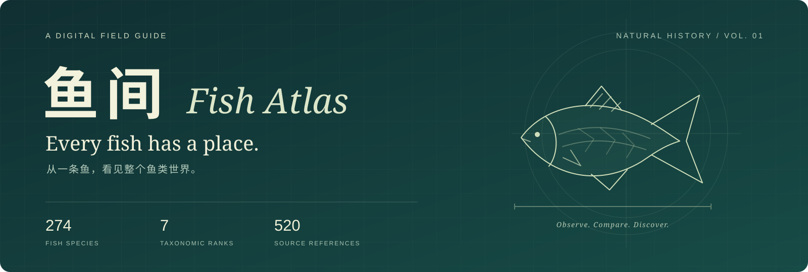
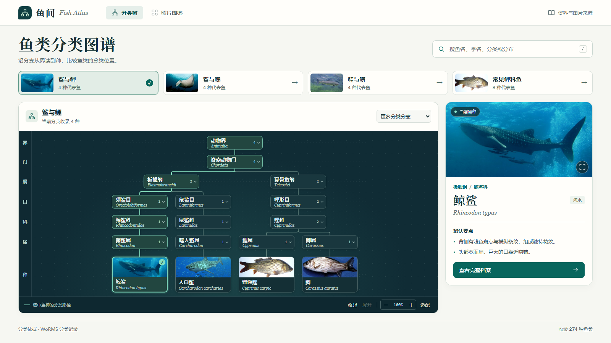
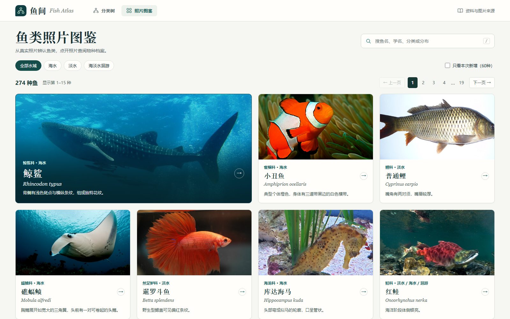
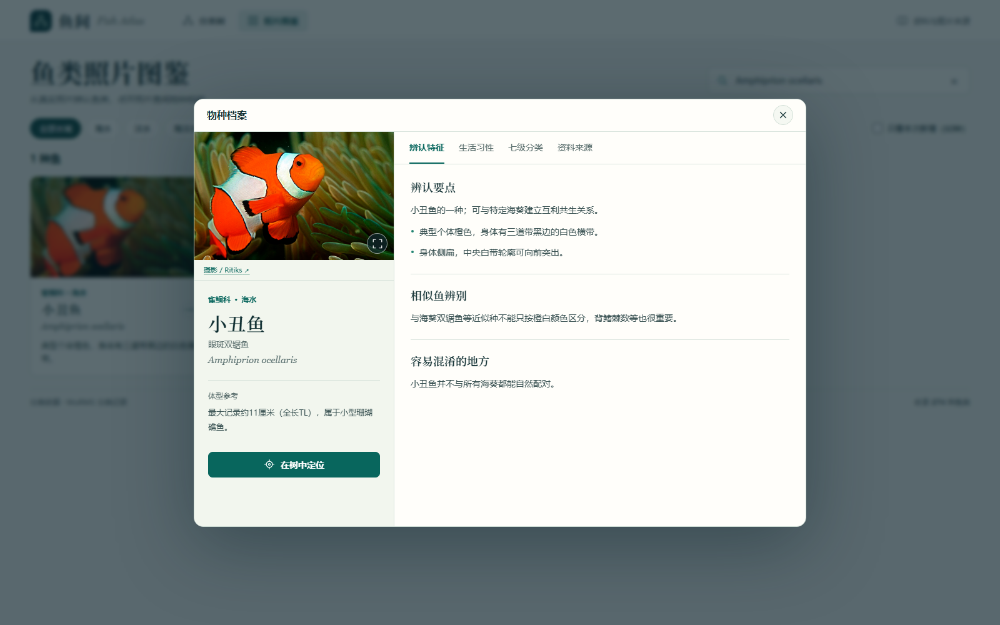

<div align="center">



**Every fish has a place.**

A quiet, visual way to explore fish — from a photograph to a species, from a species to its place in the tree.

[**Explore the atlas →**](https://cnqqc.github.io/fish-atlas/) · [中文](README.md) · **English**

**274 species** &nbsp; / &nbsp; **7 taxonomic ranks** &nbsp; / &nbsp; **520 source links** &nbsp; / &nbsp; **No framework. No build.**

</div>

---

Fish Atlas brings the feel of a natural history collection to the browser. Follow a branch, look closely at a photograph, and discover the features and habits behind a familiar name.

The interface is currently in Chinese; scientific names and source records make it easy to explore across languages.

<a href="https://cnqqc.github.io/fish-atlas/?fish=whale&amp;scope=compare#graph"></a>

## Two ways in. One collection.

| Follow the branches | Start with a photograph |
| --- | --- |
| Move from kingdom to species through seven ranks. Fold branches, drag the canvas, zoom in, and follow the selected fish's classification path. | Browse a photographic catalog, filter by habitat, and open a species record when something catches your eye. |
| [Compare sharks and carp →](https://cnqqc.github.io/fish-atlas/?fish=whale&scope=compare#graph) | [Browse marine fish →](https://cnqqc.github.io/fish-atlas/?water=marine#catalog) |



## Look closer

Each species record brings its photograph, names, classification, and field notes into one reading space.

- **Recognition** — distinguishing features, with comparisons where available.
- **Natural history** — distribution, habitat, size, diet, behavior, and breeding notes where documented.
- **Classification** — Chinese and scientific names across all seven ranks, plus related fish in the collection.
- **References** — source pages, photographer credits, image licenses, and image processing notes.



[Open the clownfish branch →](https://cnqqc.github.io/fish-atlas/?fish=clown#graph)

## Small details, considered

- Search Chinese names, aliases, scientific names, taxonomic groups, or distribution. Press `/` to begin.
- Use arrow keys and Enter to navigate search suggestions; explore record tabs with the keyboard.
- Move from a species record directly to its position in the classification tree.
- Share a URL with the selected fish, branch, search, and habitat filters preserved.
- Browse local photographs without requesting an external image service.
- Open the collection without an account, server application, or API key.

## Run it locally

With Git and Python installed:

```sh
git clone https://github.com/CNQQC/fish-atlas.git
cd fish-atlas
python -m http.server 8000 --directory dist
```

Open [localhost:8000](http://localhost:8000). On Windows, use `py` in place of `python` if that is your installed launcher.

There is nothing to install or compile. The `dist/` directory is the application source and can be served by any static web host. Local images and data are included; opening external references requires an internet connection.

## Under the surface

```text
dist/
├── index.html            Entry point
├── app.js                Navigation, search, filters, and URL state
├── tree-view.js          Interactive classification tree
├── catalog-view.js       Photographic catalog
├── specimen-view.js      Species records and source browser
├── data.js               Species names and natural history basics
├── taxonomy.js           Seven-rank classification records
├── profiles.js           Recognition and natural history notes
├── photos-data.js        Image attribution and license metadata
├── *.css                 Layout and visual design
└── assets/               Local photographs
scripts/
└── verify.mjs            Data and asset validation
```

Plain HTML, CSS, and JavaScript. The views share four data collections, joined by a stable species `id`. Classification connectors are drawn with SVG; the interface uses native browser controls and dialogs.

After editing data or assets, run the checks with Node.js:

```sh
node scripts/verify.mjs
```

## A collection with a paper trail

The current collection contains **274 fish**, spanning **10 classes, 58 orders, 122 families, and 213 genera**. Species profiles include **520 source links**; this is a count of links, not unique publications.

Classification follows the WoRMS/FishBase records linked in each entry. The tree displays seven selected ranks — kingdom, phylum, class, order, family, genus, and species — and omits intermediate ranks. It presents taxonomic placement rather than a time-scaled evolutionary phylogeny.

Photographs retain their individual attribution and license records. A small number use a same-genus representative or a historical scientific name, as explained in the photo metadata. Natural history notes vary in depth, and some comparison or breeding fields remain unfilled.

This is a curated educational collection, with room to grow. It supports visual exploration and manual recognition; it does not identify fish automatically from uploaded images.

## Help the collection grow

A well-sourced correction is as valuable as a new species.

- Improve a Chinese name, recognition cue, or natural history note with a supporting reference.
- Add a species with matching taxonomy, profile, photograph, and image attribution records.
- Improve keyboard access, mobile browsing, or the clarity of the interface.

See [CONTRIBUTING.md](CONTRIBUTING.md) for the contribution workflow. Use [Issues](https://github.com/CNQQC/fish-atlas/issues) to report a problem or discuss an idea.

Possible next directions include an English interface, richer species comparisons, and broader species coverage. These are ideas for discussion, rather than committed features or delivery dates.

## Credits and licensing

Application code is released under the [MIT License](LICENSE). That license **does not cover the datasets, third-party photographs, or screenshots containing those photographs**. Refer to [Third-party notices](THIRD_PARTY_NOTICES.md) and the [photo credits](docs/PHOTO_CREDITS.md) before reusing those materials.

Image licenses vary, including CC BY, CC BY-SA, public-domain designations, and three CC BY-NC images with noncommercial restrictions. Preserve the applicable attribution and follow each image's license.

With thanks to the photographers, observers, and maintainers behind the linked WoRMS, FishBase, Wikimedia Commons, iNaturalist, and other source records.

---

<div align="center">

**A little more curiosity. A little closer to the water.**

[Explore Fish Atlas](https://cnqqc.github.io/fish-atlas/) · [Contribute a reference](CONTRIBUTING.md) · [Read in Chinese](README.md)

</div>
