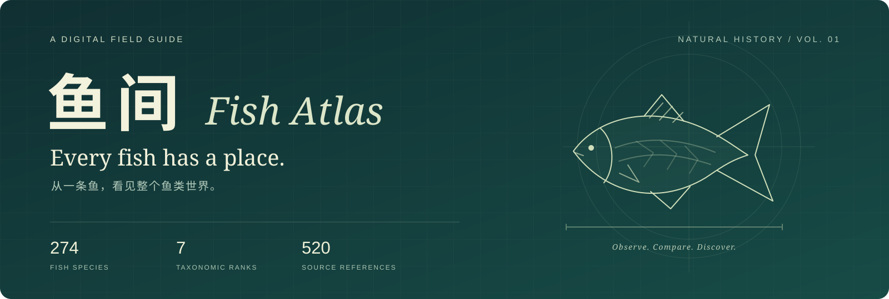
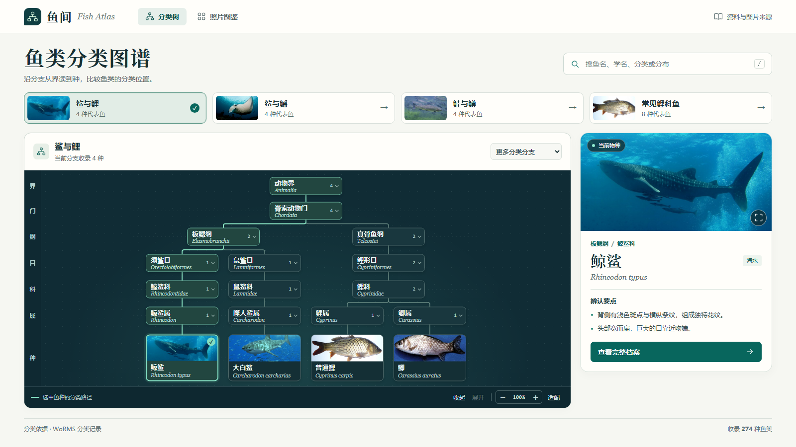
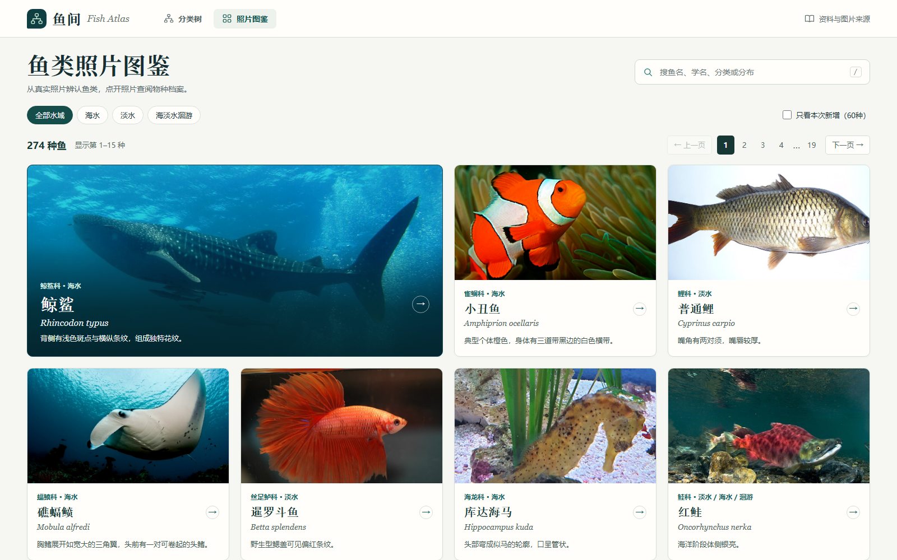
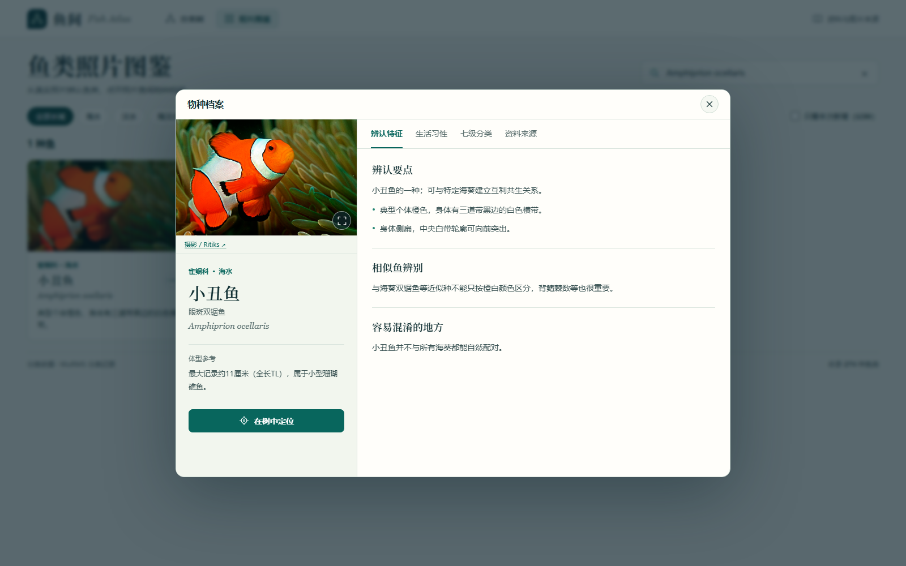

<p align="center">
  
</p>

<p align="center">
  <strong>从一条鱼，看见整个鱼类世界。</strong><br>
  把分类关系、真实照片与自然史知识，放进一座可以探索的数字图鉴。
</p>

<p align="center">
  <a href="https://cnqqc.github.io/fish-atlas/"><strong>开始探索 ↗</strong></a> ·
  <a href="#三步在本地打开">本地运行</a> ·
  <a href="#让图鉴继续生长">参与共建</a> ·
  <a href="README.en.md">English</a>
</p>

<p align="center">
  
  
  
  <a href="https://github.com/CNQQC/fish-atlas/actions/workflows/check.yml"></a>
  <a href="LICENSE"></a>
</p>

<br>

<a href="https://cnqqc.github.io/fish-atlas/"></a>

<p align="center"><sub>真实运行界面 · 中文界面 · 原生 HTML / CSS / JavaScript · 无需构建</sub></p>

## 认识一条鱼，也认识它的位置

鲸鲨为什么是鱼？名字里都有“鳗”，就一定是近亲吗？菜市场里的鱼、水族箱里的鱼、海洋里的鱼，究竟如何联系起来？

**鱼间（Fish Atlas）**希望让这些问题变得看得见、点得开、查得到。沿分类树向下寻找，在照片之间辨认差异，再打开档案，读懂一条鱼的形态、分布与生活。

它适合好奇的自然观察者，也适合课堂演示、亲子探索，以及想亲手扩充图鉴的开发者。当前收录 **627 种鱼类、10 纲、69 目、177 科、392 属**；这是一份持续整理的精选图鉴。

## 三种方式，游进鱼类世界

| 从哪里开始 | 可以做什么 |
| :--- | :--- |
| **沿着分类树** | 从界、门、纲、目、科、属到种，展开分支、缩放与拖动，比较“鲨与鲤”“鲨与鳐”“鲑与鳟”，定位选中的鱼。 |
| **翻阅照片图鉴** | 按海水、淡水、洄游筛选，浏览分页照片，搜索中文名、别名、学名、分类与分布。 |
| **打开物种档案** | 阅读辨认线索、分布、体型与生活习性，查看相似种信息与同科鱼类，放大照片，追溯资料和图片出处。 |

<p>
  
</p>

<details>
<summary><strong>展开看一份物种档案</strong></summary>
<br>

</details>

### 试着这样探索

- [比较鲸鲨、大白鲨与鲤科鱼类](https://cnqqc.github.io/fish-atlas/?fish=whale&scope=compare#graph)：找到它们在哪一级分开。
- [翻开海水鱼图鉴](https://cnqqc.github.io/fish-atlas/?water=marine#catalog)：从一张照片开始认识新物种。
- [寻找小丑鱼的分类位置](https://cnqqc.github.io/fish-atlas/?fish=clown#graph)：从熟悉的鱼，认识它的家族。

按 `/` 聚焦搜索；用方向键选择搜索建议，按 `Enter` 打开。页面地址会记录选中的物种、分类分支及图鉴筛选，方便收藏与分享。

## 三步，在本地打开

只需要 **Git 和 Python 3**。无需安装前端依赖、申请 API 密钥或配置数据库。

```bash
git clone https://github.com/CNQQC/fish-atlas.git
cd fish-atlas
python -m http.server 8000 --directory dist
```

在浏览器打开 **[localhost:8000](http://localhost:8000)**。Windows 也可以把最后一行的 `python` 换成 `py`。

所有界面资源、物种记录和图鉴照片都随仓库提供。本地服务启动后，浏览图鉴无需外部接口；点击资料与许可链接时需要网络。

### 部署也很轻

`dist/` 就是可直接发布的网站源码，上传到支持静态文件的托管服务即可。仓库附带 GitHub Pages 发布流程，`main` 分支更新后自动部署。

## 小而透明的结构

```text
fish-atlas/
├── dist/                   # 可直接运行、修改的网页源码
│   ├── index.html          # 页面入口
│   ├── app.js              # 搜索、筛选、导航与地址状态
│   ├── tree-view.*         # 分类树
│   ├── catalog-view.*      # 照片图鉴
│   ├── specimen-view.*     # 物种档案
│   ├── data.js             # 物种基础信息
│   ├── taxonomy.js         # 七级分类记录
│   ├── profiles.js         # 自然史档案与资料来源
│   ├── photos-data.js      # 图片作者、许可与来源
│   └── assets/             # 本地照片及署名数据
├── docs/PHOTO_CREDITS.md    # 逐图署名表
├── scripts/verify.mjs       # 数据与资源完整性检查
└── .github/workflows/      # 校验与静态发布
```

这里没有隐藏的构建产物：修改 `dist/`，刷新页面就能看到结果。提交前，用 **Node.js 22 或更新版本**运行：

```bash
node scripts/verify.mjs
```

检查涵盖物种 ID、分类与学名的一致性、档案结构、本地照片、图片署名和 JavaScript 语法；持续集成也会运行同一套检查。

## 每一条知识，都值得有出处

分类记录保留 [WoRMS](https://www.marinespecies.org/) 等来源，物种档案链接至 FishBase、博物馆、研究和自然观察机构等资料；每张照片记录原始页面、作者与许可证。可以在界面中点击“资料与图片来源”，也可以直接查阅 [图片署名表](docs/PHOTO_CREDITS.md)。

读图时，请记住三个边界：

- **分类层级不等于演化时间。** 图中展示七个选定阶元，省略中间阶元；分支长度不代表亲缘距离或年代。
- **图鉴仍在生长。** 当前收录并不覆盖全部鱼类，部分档案字段尚待补充；分类与学名也会随研究更新。
- **照片需要结合记录理解。** 少量图片采用同属代表、观赏品系或历史鉴定名称，具体以图片记录和原始来源为准；本项目不提供自动识鱼。

### 代码开放，图片保留各自许可

原创界面代码与原创文档采用 [MIT License](LICENSE)。第三方照片、含照片的截图、物种资料与分类数据**不包含在这份 MIT 授权中**。

图片使用多种许可证，其中 **3 张采用 CC BY-NC 4.0**；另有署名、相同方式共享等条件。再次发布、修改或用于商业用途前，请逐项核对 [第三方内容说明](THIRD_PARTY_NOTICES.md) 与 [图片署名表](docs/PHOTO_CREDITS.md)。

## 让图鉴继续生长

你不必先会写代码。指出一处错名、补充一条可靠资料、提供一张授权清晰的照片，都能让下一位读者看得更准确。

| 想贡献什么 | 从这里开始 |
| :--- | :--- |
| 分类、学名或知识修订 | 提交[资料纠错](https://github.com/CNQQC/fish-atlas/issues/new?template=species.yml)，附上可核对的来源。 |
| 照片或新物种 | 阅读[贡献指南](CONTRIBUTING.md)，准备学名、资料出处与图片授权。 |
| 交互、可访问性或代码改进 | [报告问题](https://github.com/CNQQC/fish-atlas/issues/new?template=bug.yml)，或提交一个专注的 Pull Request。 |

接下来想和社区一起探索的方向：

- [ ] 补齐相似种辨别与繁殖资料，持续校对分类记录。
- [ ] 用授权更宽松的照片替换非商业许可图片。
- [ ] 扩展中文别名与英文内容，降低跨语言探索门槛。
- [ ] 改进小屏幕浏览、键盘操作与辅助技术体验。

这些是共建方向，欢迎在 [Issues](https://github.com/CNQQC/fish-atlas/issues) 中讨论优先级。

---

<p align="center">
  <strong>鱼有千姿，皆有所归。</strong><br>
  <sub>感谢每一位摄影者、资料维护者与贡献者，让知识与好奇心继续流动。</sub><br><br>
  <a href="https://cnqqc.github.io/fish-atlas/">打开鱼间 ↗</a> · <a href="https://github.com/CNQQC/fish-atlas/issues">留下发现</a>
</p>
